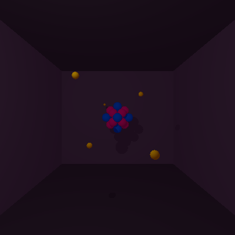
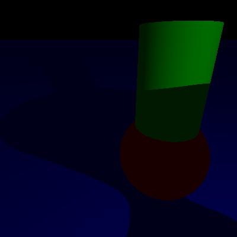
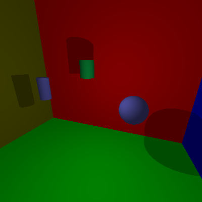
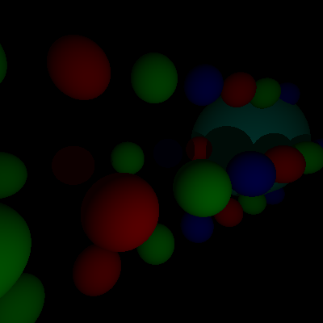
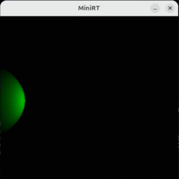

_This project has been created as part of the 42 curriculum by darmarti and alepinto._

# miniRT

## Description

miniRT is a 42 project that introduces ray tracing in C. It parses a `.rt`
scene file, casts one ray per pixel, computes object intersections and
lighting, and displays the result in an MLX42 window.

This repository contains two versions:

- `minirt_basic/`: mandatory version with spheres, planes and cylinders.
- `minirt_bonus/`: bonus version with cones, paraboloids and hyperboloids in
  addition to the mandatory objects.

Both versions use an 800 × 800 window and support ambient lighting, one camera,
one point light and colored objects.

## Gallery

### Atom



### Multi-object scene



### Room



### Spheres



### Demo



## Requirements

- Linux
- A C compiler (`cc`)
- `make`
- `cmake`
- GLFW development files required by MLX42

On Debian/Ubuntu, the usual dependencies can be installed with:

```bash
sudo apt update
sudo apt install build-essential cmake libglfw3-dev
```

MLX42 is cloned automatically by the Makefile when it is not present.

## Build and run

Choose the version you want to run:

```bash
cd minirt_basic
make
./miniRT scenes/default.rt
```

For the bonus version:

```bash
cd minirt_bonus
make
./miniRT scenes/pretty/room.rt
```

Useful Make targets:

```bash
make clean    # Remove object files and clean libft
make fclean   # Remove objects, libraries, MLX42 build files and the binary
make re       # Full rebuild
make debug    # Build with debug symbols and AddressSanitizer
make norme    # Run Norminette on the source and headers
```

The program expects exactly one argument, and the scene file must have the
`.rt` extension:

```bash
./miniRT path/to/scene.rt
```

### GNOME/VS Code Snap troubleshooting

If running the program aborts with an error similar to:

```text
Settings schema 'org.gnome.settings-daemon.plugins.xsettings'
does not contain a key named 'antialiasing'
```

the problem is caused by a stale or mismatched system GSettings schema, not by
the scene parser or by MLX42. The source schema on Ubuntu should contain the
`antialiasing` key. Rebuild the system schema cache:

```bash
sudo glib-compile-schemas /usr/share/glib-2.0/schemas
```

When launching from VS Code Snap, its `XDG_DATA_DIRS` can still make GLib load
the Snap's schema cache. Start miniRT with a clean graphical environment:

```bash
env -u XDG_DATA_DIRS \
    -u GSETTINGS_SCHEMA_DIR \
    -u GTK_PATH \
    -u GTK_EXE_PREFIX \
    -u GTK_IM_MODULE_FILE \
    -u GTK_MODULES \
    -u GDK_PIXBUF_MODULEDIR \
    -u GDK_PIXBUF_MODULE_FILE \
    GSETTINGS_BACKEND=memory \
    ./miniRT scenes/pretty/atom.rt
```

If the problem persists in a regular system terminal, reinstall the package
that provides the schema and rebuild it:

```bash
sudo apt install --reinstall gnome-settings-daemon-common
sudo glib-compile-schemas /usr/share/glib-2.0/schemas
```

Then run miniRT normally. Running it from a regular system terminal instead
of the VS Code Snap terminal can also avoid Snap-specific environment issues.

## Controls

| Key | Action |
| --- | --- |
| `W` / `S` | Move the camera forward / backward |
| `A` / `D` | Move the camera left / right |
| `Q` / `E` | Move the camera down / up |
| Arrow keys | Rotate the camera |
| `ESC` | Close the window |

## Scene format

A scene is a plain-text file with one object per line. Coordinates and
normalized vectors are comma-separated; colors use RGB values from `0` to
`255`.

### Global elements

```text
A  lighting_ratio  R,G,B
C  x,y,z  nx,ny,nz  field_of_view
L  x,y,z  brightness_ratio  R,G,B
```

Each scene must contain one ambient light (`A`) and one camera (`C`). It can
contain one point light (`L`) and multiple objects.

### Mandatory objects

```text
sp  x,y,z  diameter  R,G,B
pl  x,y,z  nx,ny,nz  R,G,B
cy  x,y,z  ax,ay,az  diameter  height  R,G,B
```

The bonus version additionally accepts:

```text
co  x,y,z  ax,ay,az  diameter  height  R,G,B
pb  x,y,z  ax,ay,az  k_factor  height_limit  R,G,B
hb  x,y,z  ax,ay,az  a  b  c  height_limit  R,G,B
```

Ready-to-use examples are available in the `scenes/` directories, including
valid shape demonstrations and invalid parser test cases.

## Implementation highlights

- Scene parsing with validation and explicit error handling.
- Vector operations and Rodrigues rotation for camera movement.
- Ray intersections for the supported geometric primitives.
- Ambient, diffuse and point-light shading.
- MLX42 rendering and real-time camera interaction.

## Resources

- [MLX42 documentation](https://github.com/codam-coding-college/MLX42)
- [The Ray Tracer Challenge](https://pragprog.com/book/jbtracer/the-ray-tracer-challenge)
